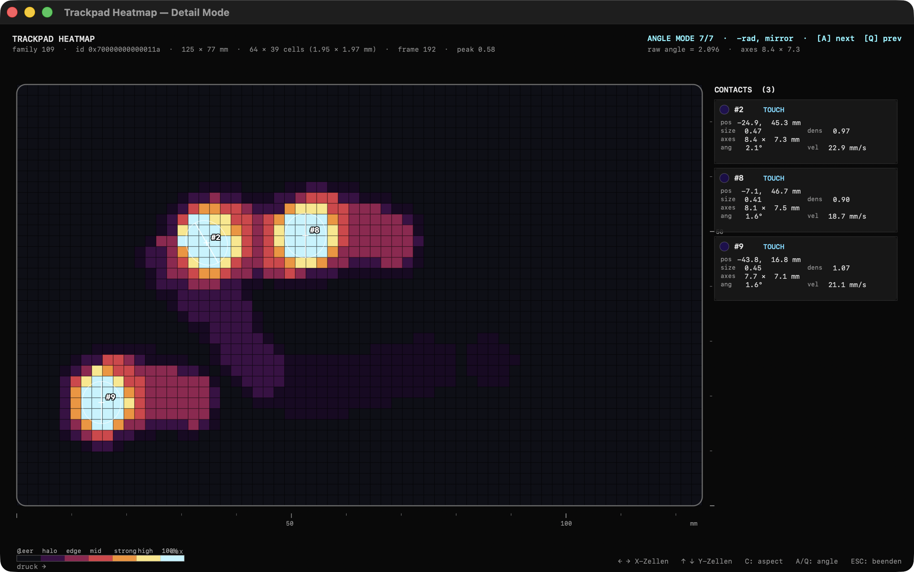

# Trackpad Heatmap

> Real-time heatmap of every MacBook trackpad contact point, read straight from macOS's private MultitouchSupport framework.

A native macOS tool written in Swift that visualizes all live trackpad contacts — position, size, pressure proxy, angle, and ellipse axes — as a colored heatmap. It reads the raw touch data directly from the private `MultitouchSupport.framework` (the same source the internal Apple diagnostics tools use) via `dlopen`/`dlsym`, including pulling the framework out of the dyld shared cache on Apple Silicon. Lay your whole hand on the trackpad and you can clearly see the palm as a large ellipse plus the five fingers as smaller ones.

## Features

- Real-time visualization of all trackpad contacts as a colored heatmap with discrete pressure steps (LED-grid look)
- Reads raw data from the private `MultitouchSupport.framework` via `dlopen`/`dlsym`, including resolving it from the dyld shared cache on Apple Silicon
- Each contact drawn as a rotated ellipse with major/minor axis (in mm), angle, and a pressure proxy
- Persistence buffer with slow decay builds a lingering hand "imprint" over time
- 2D Gaussian-splat field computation with 4×4 subsampling for clean anti-aliasing of the ellipses
- Side panel with live per-contact detail (position, size, density, axes, angle, velocity, touch state)
- Reads the physical trackpad dimensions in mm, plus the device's FamilyID and DeviceID
- mm scale with tick marks and a colorbar legend
- Eight switchable angle conventions for calibrating ellipse orientation
- Keyboard controls: grid resolution (arrow keys for X/Y), aspect reset, angle mode, peak reset, ESC to quit
- Inferno colormap implementation plus state-dependent color coding of touch states
- Supports external Magic Trackpads via `MTDeviceCreateDefault`

## Tech Stack

- **Swift** (compiled with `swiftc -O`, Command Line Tools only — no Xcode required)
- **AppKit** for the window and rendering loop
- **Core Graphics / Quartz** for drawing
- **CVDisplayLink** for the render tick
- **MultitouchSupport.framework** (private macOS framework, loaded dynamically at runtime)

## Getting Started

### Requirements

- A Mac with a built-in or external Multitouch trackpad (Magic Trackpad supported)
- Xcode Command Line Tools (`xcode-select --install`)

### Build & Run

```bash
chmod +x build.sh
./build.sh          # compiles main.swift to the trackpad-heatmap binary
./trackpad-heatmap  # opens the window
```

Press **ESC** to quit.

### Controls

| Key       | Action                          |
| --------- | ------------------------------- |
| `←` / `→` | Decrease / increase X grid cells |
| `↑` / `↓` | Increase / decrease Y grid cells |
| `C`       | Reset grid to trackpad aspect    |
| `A` / `Q` | Cycle angle convention forward / back |
| `R`       | Reset peak                       |
| `ESC`     | Quit                             |

## Project Status

Complete and working. This is a functional prototype / exploration tool.

A few honest caveats worth knowing:

- `MultitouchSupport.framework` is a **private** Apple framework, so the `Finger` struct layout could change in a future macOS release. It has been stable across macOS 12–15.
- On Apple Silicon the framework lives in the dyld shared cache rather than on disk; `dlopen` still resolves it.

## Screenshots



## How it was made

Built with the help of an AI coding agent (Claude Code).

## License

MIT, see [LICENSE](LICENSE).
